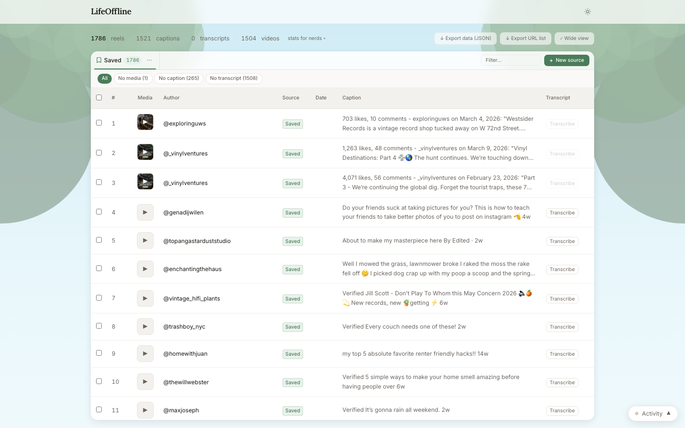

# LifeOffline

Locally-hosted tool to scrape, download, caption, and transcribe Instagram reels from your DMs or saved posts. Nothing leaves your machine.



---

## Quickstart

**Requirements:** Python 3.11+, Node.js 18+, ffmpeg

```bash
git clone <repo>
cd ig-personal-dm-scrapper
./start.sh
```

Open **http://localhost:3000**

That's it. `start.sh` installs all dependencies and starts both servers on first run (~2 min, one-time).

---

## First use

1. Click **+ Add source**
2. Choose **DM Thread** (paste thread URL) or **Saved Posts** (paste your username)
3. Click **Scrape & add** — a browser window opens for Instagram login on first run
4. Once scraped: use **Captions**, **Download media**, **Transcribe** buttons per tab

> Session is saved to `data/session.json` and reused. Delete it to force re-login.

---

## [Full documentation →](docs/DOCS.md)

Covers: GPU transcription · troubleshooting · data files · Docker · rate limits · filter chips · batch actions
