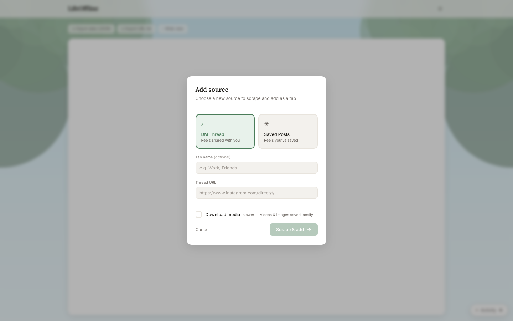

# LifeOffline — Full Documentation

## Contents

1. [How it works](#how-it-works)
2. [Setup](#setup)
3. [Adding sources](#adding-sources)
4. [Table actions](#table-actions)
5. [Filter chips & batch actions](#filter-chips--batch-actions)
6. [Data files](#data-files)
7. [GPU transcription](#gpu-transcription)
8. [Rate limits](#rate-limits)
9. [Troubleshooting](#troubleshooting)
10. [Docker](#docker)

---

## How it works

LifeOffline runs two local servers:

| Server | Port | Role |
|--------|------|------|
| FastAPI backend | 8000 | Playwright browser automation, instaloader downloads, Whisper transcription, SQLite DB |
| Next.js frontend | 3000 | UI — connects to backend via HTTP + WebSocket |

All data is stored in `data/` inside the project directory. No external APIs, no cloud storage.

---

## Setup

### Prerequisites

| Dependency | Minimum | Install |
|------------|---------|---------|
| Python | 3.11+ | [python.org](https://python.org) |
| Node.js | 18+ | [nodejs.org](https://nodejs.org) |
| ffmpeg | any | `brew install ffmpeg` / `apt install ffmpeg` |

### First run

```bash
./start.sh
```

On first run this will:
- Create `.venv/` Python virtual environment
- `pip install` all Python dependencies (`requirements.txt`)
- Download Playwright Chromium browser (~150 MB, cached after)
- `npm install` frontend dependencies
- Start backend on port 8000 and frontend on port 3000

Subsequent runs are fast — dependencies are cached.

Open **http://localhost:3000**

---

## Adding sources

Click **+ Add source** to open the source dialog.



### DM Thread

- **Tab name** (optional): label shown on the tab, e.g. "Work" or "Friends"
- **Thread URL**: `https://www.instagram.com/direct/t/<thread_id>/`
  - Find it by opening a DM conversation in your browser and copying the URL from the address bar
- **Download media**: check this to also download videos/images locally during scrape (slower)

### Saved Posts

- **Tab name** (optional)
- **Instagram username**: your own username (or whoever's saved posts you have access to)

### First-time login

When no `data/session.json` exists, scraping opens a visible Chromium window at Instagram's login page. Log in normally (including 2FA). The session is saved automatically and reused on all future runs.

To force re-login: delete `data/session.json` and scrape again.

---

## Table actions


Each tab corresponds to a source. Within a tab:

| Button | What it does |
|--------|-------------|
| **Captions** | Fetches caption text for every reel missing one (opens headless browser) |
| **Download media** | Downloads videos/images via instaloader for every reel missing local media |
| **Transcribe** | Extracts audio from downloaded videos and transcribes with Whisper (local) |
| **↓ Export data (JSON)** | Downloads `reels.json` with all fields |
| **↓ Export URL list** | Downloads a plain text file of reel URLs |

> **Transcribe requires media downloaded first.** The Transcribe button is disabled per-row and in batch if no local video exists.

Per-row actions (hover a row):
- **Thumbnail** — click to open video/image viewer
- **Caption cell** — click refresh icon to re-fetch just that caption
- **Transcript cell** — click to transcribe just that reel (if media downloaded), or copy if already done

---

## Filter chips & batch actions

The filter bar above the table has four chips:

| Chip | Shows |
|------|-------|
| All | Everything |
| No media | Reels with no downloaded video/image |
| No caption | Reels missing caption text |
| No transcript | Video/carousel reels missing transcript |

Selecting rows (checkbox column) reveals the **batch action bar**:
- **Download** — download media for selected rows only
- **Captions** — fetch captions for selected rows only
- **Transcripts** — transcribe selected rows only (disabled if none have local video)

Use filter + select-all to quickly re-run failed items.

---

## Data files

| Path | Description |
|------|-------------|
| `data/reels.db` | SQLite database — primary store |
| `data/media/<shortcode>/` | Downloaded images and videos per post |
| `data/audio/<shortcode>.mp3` | Extracted audio for transcription |
| `data/session.json` | Instagram session cookies (Playwright storage state) |

Export from the UI to get portable JSON/URL list files.

---

## GPU transcription

By default Whisper runs on CPU (`base` model, `int8`). For CUDA GPU:

```bash
WHISPER_DEVICE=cuda ./start.sh
```

The model downloads ~150 MB on first use and is cached in `~/.cache/huggingface/`.

---

## Rate limits

Instagram rate-limits heavily, especially with authenticated sessions.

| Situation | What happens |
|-----------|-------------|
| Public content | Downloaded anonymously via instaloader — lower rate-limit risk |
| Age-restricted / private content | Falls back to session cookies automatically — 3 anonymous attempts then 2 authenticated |
| 429 Too Many Requests | Instaloader retries with 5s backoff; authenticated path has longer waits |
| Saved posts rate-limit (~270+ posts) | Scraper detects 5 consecutive empty responses and stops with a warning |

If a job stalls with no activity for **5 minutes**, it auto-cancels with a message to re-run. Re-running resumes from already-scraped data — nothing is lost.

---

## Troubleshooting

| Problem | Fix |
|---------|-----|
| Port 8000 or 3000 already in use | `lsof -i :8000` / `lsof -i :3000` to find and kill the process |
| Session expired | Delete `data/session.json`, scrape again to re-login |
| "No sources yet" after re-opening | Sources are stored in browser localStorage — use the same browser |
| Thumbnails not showing | For saved posts: re-scrape to capture fresh CDN URLs. For downloaded posts: thumbnails load from local files automatically |
| Transcribe button disabled | Download media for that reel first |
| ffmpeg not found | `brew install ffmpeg` (macOS) or `apt install ffmpeg` (Linux) |
| Whisper out of memory | Edit `backend/enricher.py` — change `"base"` to `"tiny"` in `_get_whisper(...)` call |
| Instaloader 403 errors in terminal | Normal — suppressed internally, does not affect downloads |
| Age-restricted content fails | Ensure `data/session.json` exists (run any scrape to log in first) |

---

## Docker

> Docker cannot open a visible browser window. Complete first-time login with `./start.sh` before using Docker.

```bash
# Step 1 — first time only (creates data/session.json)
./start.sh
# Log in to Instagram in the browser window that opens, then Ctrl+C

# Step 2 — all subsequent runs
docker-compose up
```
